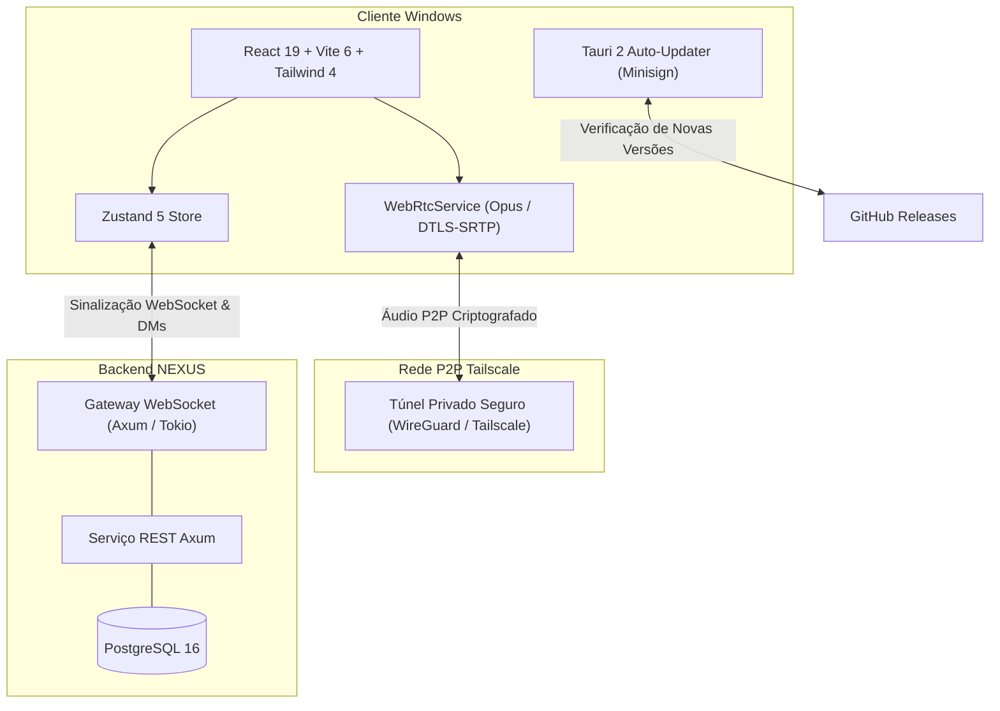

<div align="center">

# ⚡ NEXUS Desktop

**Aplicativo de comunicação de voz e texto de alta performance para Windows 11.**  
*Inspirado na organização estruturada da Steam e na estética gamer escura do Opera GX.*

[](https://tauri.app)
[](https://www.rust-lang.org)
[](https://react.dev)
[](https://vitejs.dev)
[](https://tailwindcss.com)
[](https://webrtc.org)
[](https://tailscale.com)

</div>

---

## 📌 Última Atualização & Notas de Versão (Patch Notes)

> **Versão Atual:** `v0.1.1` • **Data:** 07 de Novembro de 2026 • **Status:** Release Estável

### 📋 Resumo das Mudanças (v0.1.1)
- 🎨 **Temas Dinâmicos e Aparência:** Três esquemas visuais em tempo real (*NEXUS Dark*, *Midnight Steam* para OLED e *Cyber Slate* neon Opera GX), escala ajustável de tipografia e modo compacto de mensagens.
- 📷 **Foto de Perfil Personalizada:** Suporte completo a upload de fotos de perfil locais, com pré-visualização, persistência e exibição na barra lateral e chats.
- 👥 **Detecção Rigorosa de Amigos Offline:** Sincronização automática que marca amigos como offline assim que fecham o aplicativo, com timeout de inatividade de 60s no servidor para quedas de conexão.
- 🎧 **Retorno de Áudio no Teste de Microfone:** O teste de microfone agora possui retorno em tempo real nos fones/alto-falantes para você ouvir exatamente como sua voz e o cancelamento de ruído soam.
- 🔔 **Efeitos Sonoros de Mute & Unmute:** Alertas acústicos sintetizados instantaneamente via Web Audio API ao silenciar ou reativar o microfone.
- 🏷️ **Alinhamento de Versão e Interface:** Versão do topo sincronizada com `v0.1.1` e selo de status limpo sem referências técnicas ao PostgreSQL.

*(Para ver os detalhes técnicos completos, consulte a [Aba de Releases](https://github.com/Sinisterzs/NEXUS/releases)).*

---

## 🌟 Principais Recursos

- **Ultraleve e Econômico:** Desenvolvido em Tauri 2 e Rust, consumindo menos de 45 MB de RAM (em contraste com clientes Electron convencionais).
- **Rede P2P Privada:** Comunicação de voz com ultra baixa latência por rotas seguras do Tailscale.
- **Barra de Chamada Persistente:** Controle chamadas ativas de qualquer tela do aplicativo (navegando por mensagens, configurações ou início) com a dock flutuante.
- **Segurança de Ponta a Ponta:** Autenticação robusta (Google OAuth + credenciais locais protegidas), PostgreSQL com migrações gerenciadas e Gateway WebSocket assíncrono em Axum/Tokio.

---

## 🏗️ Arquitetura do Sistema



---

## 🛠️ Tecnologias Utilizadas

| Camada | Tecnologia | Propósito |
| :--- | :--- | :--- |
| **Desktop Core** | [Tauri 2](https://tauri.app) + Rust | Empacotamento nativo Windows com WebView2 e consumo mínimo de recursos |
| **Frontend** | [React 19](https://react.dev) + [TypeScript](https://www.typescriptlang.org) | Interface moderna, reativa e tipada |
| **Estilização** | [Tailwind CSS 4](https://tailwindcss.com) | Design tokens de alta performance inspirados no Opera GX e Steam |
| **Mídia de Voz** | WebRTC + Codec Opus | Transmissão de áudio em tempo real com supressão de ruído e cancelamento de eco |
| **Rede Privada** | [Tailscale](https://tailscale.com) | Malha P2P segura para sinalização e transporte de mídia direta |
| **Backend Servidor**| [Axum](https://github.com/tokio-rs/axum) + [Tokio](https://tokio.rs) | Servidor assíncrono em Rust para presença, DMs e sinalização de chamadas |
| **Banco de Dados**| [PostgreSQL](https://www.postgresql.org) + [SQLx](https://github.com/launchbadge/sqlx) | Persistência relacional robusta com migrações atômicas |
| **Assinatura** | Minisign | Assinatura digital criptográfica dos pacotes de atualização |

---

## 🚀 Como Executar

### Pré-requisitos
- **Sistema Operacional:** Windows 10 ou 11 (64-bit)
- **Node.js:** Versão 20+ ou 22 LTS
- **Rust Toolchain:** Versão 1.80+ (com `x86_64-pc-windows-msvc`)
- **Tailscale:** Instalado e conectado à sua rede privada

### 1. Clonar o Repositório
```bash
git clone https://github.com/Sinisterzs/NEXUS.git
cd NEXUS
```

### 2. Instalar Dependências
```bash
npm install
```

### 3. Modo de Desenvolvimento
```bash
# Executar a aplicação desktop com Hot Module Replacement (HMR)
npm run desktop:dev
```

### 4. Compilar Versão de Produção (Release)
```bash
# Gera o executável otimizado em src-tauri/target/release/nexus.exe
npm run desktop:build
```

### 5. Gerar e Assinar Atualização Automática
```bash
# Compila, assina com chave Minisign e prepara pacote para o GitHub Releases
npm run release:update
```

---

## 🔒 Segurança e Privacidade

- **Sem Telemetria Oculta:** O NEXUS não coleta dados pessoais, não injeta rastreadores e não envia áudio para servidores terceiros.
- **Chaves Privadas Protegidas:** Nenhuma chave de assinatura (`.key`), token ou credencial `.env` é commitada no repositório.
- **Tráfego P2P:** A mídia trafega ponto a ponto criptografada, ficando restrita aos participantes autorizados.

---

<div align="center">
  <sub>Desenvolvido com foco em desempenho, privacidade e baixa latência.</sub>
</div>
