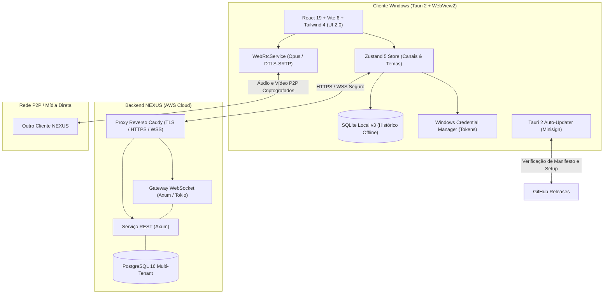

<div align="center">

# ⚡ NEXUS Desktop

**Aplicativo de comunicação de voz e texto de alta performance para Windows 11.**  
*Inspirado na organização estruturada da Steam e na estética gamer escura do Opera GX.*

[](https://tauri.app)
[](https://www.rust-lang.org)
[](https://react.dev)
[](https://vitejs.dev)
[](https://tailwindcss.com)
[](https://webrtc.org)
[](https://aws.amazon.com)

</div>

---

## 📌 Versões e Canais de Distribuição

| Canal | Versão Atual | Data | Status | Manifest do Updater |
| :--- | :---: | :---: | :---: | :--- |
| **Estável (Stable)** | `v0.1.8` | 09/11/2026 | Produção Homologada | [`latest.json`](https://github.com/Sinisterzs/NEXUS/releases/latest/download/latest.json) |
| **Pré-lançamento (Nightly)** | `v0.1.9-nightly.6` | 09/11/2026 | Consolidação UI 2.0 | [`latest-nightly.json`](https://github.com/Sinisterzs/NEXUS/releases/download/v0.1.9-nightly.6/latest-nightly.json) |
| **Próximo Marco (Roadmap)** | `v0.2.0 Stable` | Em Breve | Em Preparação | *Canal Estável após validação da Nightly.6* |

---

## 📋 Destaques da Versão Recente

### 🌙 Nightly Atual (`v0.1.9-nightly.6`)
- 🎨 **Harmonização Global de Temas (UI 2.0):** Eliminação de cores estáticas; botões, ícones, seleções e gradientes agora sincronizam instantaneamente com o tema escolhido (**NEXUS Dark**, **Midnight Black**, **Cyber Slate**).
- 👤 **Avatar com Glow Suave:** Remoção da borda quadrada sólida ao redor da foto de perfil, substituída por um brilho externo sutil que absorve o acento do tema.
- 💾 **Persistência Confiável do Canal de Atualização:** A escolha do canal (Stable ou Beta) agora persiste perfeitamente entre reinicializações através de armazenamento em dupla camada (Tauri Store + fallback local).
- 🛡️ **Segurança Criptográfica & Testes Isolados:** Aprovação visual explícita de identidade de servidor AWS (TOFU Ed25519) e isolamento rigoroso de suítes de teste (zero acesso a credenciais ou arquivos reais de usuário).

### 🏷️ Versão Estável Homologada (`v0.1.8`)
- 🔄 **Seletor de Canais Integrado:** Interface em Configurações para transição segura entre builds estáveis e experimentais.
- 🔒 **Sessões Protegidas:** Armazenamento seguro de tokens com criptografia no Windows Credential Manager.

*(Para ver os detalhes de todas as versões anteriores, consulte o [CHANGELOG.md](file:///c:/Users/kelma/Documents/Tropa/CHANGELOG.md) e a [Aba de Releases](https://github.com/Sinisterzs/NEXUS/releases)).*

---

## 🌟 Principais Recursos Implementados

- **Ultraleve e Econômico:** Desenvolvido em Tauri 2 e Rust, consumindo menos de 45 MB de RAM (em contraste com clientes Electron convencionais).
- **Interface UI 2.0:** TitleBar nativa integrada com controle de janela e busca global, Home renovada com perfil ativo e atalhos de voz, e Mensagens diretas com histórico contínuo e compositor otimizado.
- **Rede Híbrida de Alta Disponibilidade:** Conexão primária HTTPS/WSS na nuvem AWS com certificados TLS e contingência secundária P2P via malha privada Tailscale.
- **Voz e Compartilhamento P2P de Baixa Latência:** Chamadas 1on1 e compartilhamento de tela com codec Opus e negociação criptografada DTLS-SRTP.
- **Persistência Segura e Histórico Offline:** Banco SQLite local com criptografia de sessão e migrações atômicas gerenciadas.
- **Atualizador Nativo com Minisign:** Pacotes de atualização NSIS verificados criptograficamente por chave pública antes da execução.

---

## 🏗️ Arquitetura do Sistema



---

## 🛠️ Tecnologias Utilizadas

| Camada | Tecnologia | Propósito |
| :--- | :--- | :--- |
| **Desktop Core** | [Tauri 2](https://tauri.app) + Rust 1.85 | Empacotamento nativo Windows com WebView2 e baixo consumo de recursos |
| **Frontend** | [React 19](https://react.dev) + [TypeScript](https://www.typescriptlang.org) | Interface moderna, reativa e totalmente tipada |
| **Estilização** | [Tailwind CSS 4](https://tailwindcss.com) | Tokens de design semânticos dinâmicos com alternância instantânea de temas |
| **Mídia de Voz / Tela** | WebRTC + Codec Opus | Transmissão de áudio em tempo real com supressão de ruído e cancelamento de eco |
| **Backend Servidor**| [Axum](https://github.com/tokio-rs/axum) + [Tokio](https://tokio.rs) | Servidor assíncrono em Rust para presença, DMs e sinalização de chamadas |
| **Banco de Dados Nuvem**| [PostgreSQL 16](https://www.postgresql.org) + [SQLx](https://github.com/launchbadge/sqlx) | Persistência relacional robusta com migrações atômicas |
| **Banco de Dados Local**| SQLite v3 + WAL | Cache de histórico e persistência de dados offline |
| **Criptografia & Assinatura**| Ed25519 + Minisign | Validação TOFU de identidade do servidor e assinatura digital de atualizações |

---

## 🚀 Como Executar Localmente

### Pré-requisitos
- **Sistema Operacional:** Windows 10 ou 11 (64-bit)
- **Node.js:** Versão 20+ ou 22 LTS
- **Rust Toolchain:** Versão 1.80+ (com alvo `x86_64-pc-windows-msvc`)

### 1. Clonar o Repositório
```bash
git clone https://github.com/Sinisterzs/NEXUS.git
cd NEXUS
```

### 2. Instalar Dependências
```bash
npm install
```

### 3. Modo de Desenvolvimento (Vite HMR)
```bash
npm run desktop:dev
```

### 4. Executar Testes Automatizados
```bash
# Testes unitários do frontend e persistência de canais
npm test

# Testes nativos de segurança e banco de dados em Rust (isolados)
cargo test --manifest-path src-tauri/Cargo.toml
```

### 5. Compilar Versão de Produção
```bash
npm run build
```

---

## 🔒 Segurança e Privacidade

- **Isolamento de Credenciais:** Tokens de sessão são protegidos nativamente via Windows Credential Manager.
- **Identidade Criptográfica do Servidor (TOFU):** O cliente valida a chave pública Ed25519 do servidor AWS em toda conexão. Mudanças não autorizadas acionam uma tela de bloqueio e exigem aprovação explícita.
- **Testes com Isolamento Absoluto:** Nenhuma rotina de teste automatizado acessa ou modifica diretórios reais de dados, chaves de registro ou credenciais salvas.
- **Tráfego P2P Criptografado:** Sessões de áudio e tela trafegam via DTLS-SRTP ponto a ponto.

---

<div align="center">
  <sub>NEXUS Desktop • Desenvolvido com foco em desempenho, segurança e baixa latência.</sub>
</div>
