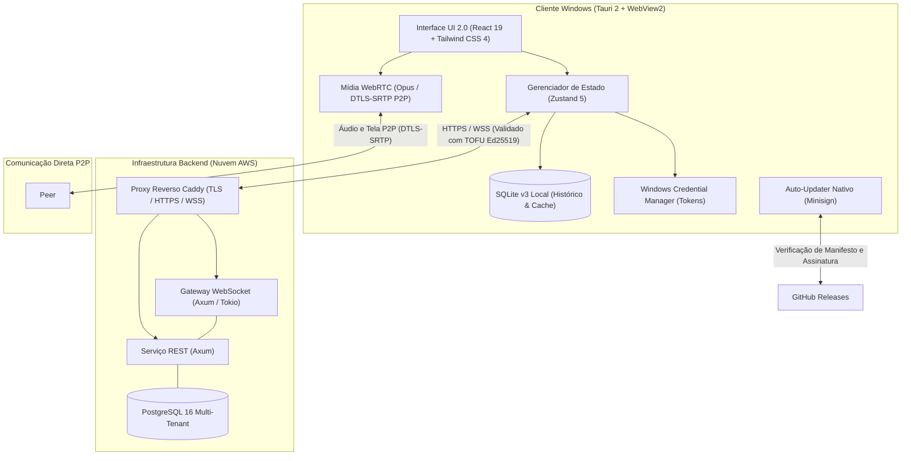

<div align="center">

# NEXUS

**Comunicação desktop rápida, elegante e de baixa latência para Windows.**

Uma plataforma de mensagens e chamadas em tempo real construída com arquitetura nativa em Rust e interface fluida em React 19, inspirada na organização da Steam e na estética gamer escura com detalhes em carmesim.

<!-- NEXUS:STABLE_HEADER_BADGE:START -->
[](https://github.com/Sinisterzs/NEXUS/releases/tag/v0.2.1)
[](https://github.com/Sinisterzs/NEXUS/releases/download/v0.2.1/nexus_0.2.1_x64-setup.exe)
<!-- NEXUS:STABLE_HEADER_BADGE:END -->
[](https://tauri.app)
[](https://www.rust-lang.org)
[](https://react.dev)
[](LICENSE)

<!-- NEXUS:STABLE_HEADER_LINKS:START -->
[**Baixar v0.2.1 Stable**](https://github.com/Sinisterzs/NEXUS/releases/download/v0.2.1/nexus_0.2.1_x64-setup.exe) • [**Notas de Lançamento**](scripts/release-notes-v0.2.1.md) • [**Releases no GitHub**](https://github.com/Sinisterzs/NEXUS/releases) • [**Histórico de Mudanças**](CHANGELOG.md)
<!-- NEXUS:STABLE_HEADER_LINKS:END -->

</div>

---

## 1. Apresentação do NEXUS

O **NEXUS** é um aplicativo desktop projetado para usuários que buscam comunicação fluida e sem sobrecarga no sistema operacional. Em vez de utilizar estruturas pesadas baseadas em navegadores completos empacotados, o NEXUS utiliza o **Tauri 2** com backend compilado nativamente em **Rust** e renderização pelo **WebView2** do próprio Windows.

Essa abordagem entrega um consumo reduzido de memória RAM e processamento, mantendo o computador responsivo para jogos, desenvolvimento e multitarefas. A interface visual — **NEXUS UI 2.0** — combina estética escura refinada, tipografia clara, acentos carmesim e controle de janela sem bordas nativas.

---

## 2. Funcionalidades Principais

- **Interface UI 2.0 Integrada:** TitleBar personalizada contínua, com controles nativos de janela (minimizar, maximizar, restaurar e fechar com microinterações), busca rápida e menu de perfil contextual.
- **Mensagens Diretas com Histórico Local:** Conversas organizadas por agrupamento contínuo de mensagens (`pl-[52px]`), compositor focado com atalhos de envio (`Enter` para enviar e `Shift + Enter` para nova linha) e banco SQLite v3 local com suporte a leitura em modo offline.
- **Chamadas de Voz 1on1 Diretas:** Comunicação de áudio ponto a ponto (P2P) de baixa latência com codec Opus e proteção de canal via DTLS-SRTP.
- **Compartilhamento de Tela P2P:** Transmissão direta de janelas ou monitores locais entre dois usuários via WebRTC, sem retenção de quadros em servidores intermediários.
- **Personalização de Temas Sem Flashes:** Três temas oficiais dinâmicos que se adaptam instantaneamente a todos os componentes, com persistência em disco e renderização síncrona no primeiro frame.
- **Seletor de Canais Integrado:** Escolha flexível nas configurações entre o canal estável (produção homologada) e o canal beta (recebimento antecipado de compilações experimentais).
- **Atualizador Automático com Minisign:** Pacotes de atualização NSIS verificados criptograficamente pela chave pública oficial do projeto antes de qualquer execução.

---

## 3. Downloads Oficiais e Canais de Atualização

O NEXUS disponibiliza instaladores assinados digitalmente para Windows de 64 bits:

<table>
  <thead>
    <tr>
      <th align="left">Canal</th>
      <th align="center">Versão</th>
      <th align="center">Status</th>
      <th align="left">Instalador Windows (64-bit)</th>
      <th align="left">Manifesto do Updater</th>
    </tr>
  </thead>
  <tbody>
<!-- NEXUS:STABLE_ROW:START -->
    <tr>
      <td align="left"><strong>Estável (Recomendado)</strong></td>
      <td align="center"><strong><code>v0.2.1</code></strong></td>
      <td align="center">Homologada</td>
      <td align="left"><a href="https://github.com/Sinisterzs/NEXUS/releases/download/v0.2.1/nexus_0.2.1_x64-setup.exe"><strong>nexus_0.2.1_x64-setup.exe</strong></a></td>
      <td align="left"><a href="https://github.com/Sinisterzs/NEXUS/releases/latest/download/latest.json"><code>latest.json</code></a></td>
    </tr>
<!-- NEXUS:STABLE_ROW:END -->
<!-- NEXUS:BETA_ROW:START -->
    <tr>
      <td align="left"><strong>Pré-lançamento (Beta)</strong></td>
      <td align="center"><code>v0.3.0-nightly.4</code></td>
      <td align="center">Homologação Ativa</td>
      <td align="left"><a href="https://github.com/Sinisterzs/NEXUS/releases/download/v0.3.0-nightly.4/nexus_0.3.0-nightly.4_x64-setup.exe">nexus_0.3.0-nightly.4_x64-setup.exe</a></td>
      <td align="left"><a href="https://github.com/Sinisterzs/NEXUS/releases/download/v0.3.0-nightly.4/latest-nightly.json"><code>latest-nightly.json</code></a></td>
    </tr>
<!-- NEXUS:BETA_ROW:END -->
  </tbody>
</table>

### Como Instalar e Atualizar
1. Baixe o instalador oficial `nexus_0.2.0_x64-setup.exe`.
2. Execute o instalador para configurar o aplicativo no seu computador.
3. Para receber novas versões automaticamente, acesse **Configurações → Sobre & Atualizações**. O aplicativo verificará o canal configurado e aplicará as atualizações assinadas com segurança.

---

## 4. Personalização e Temas da UI 2.0

O sistema de estilização do NEXUS foi inteiramente unificado com tokens semânticos de Tailwind CSS 4, permitindo alternância imediata em toda a interface sem recarregar a tela:

| Tema | Fundo Principal | Superfície dos Painéis | Acento Semântico | Estilo Visual |
| :--- | :---: | :---: | :---: | :--- |
| **NEXUS Dark (Padrão)** | `#111318` | `#1B1E25` | Carmesim (`#B8495A`) | Identidade gamer sóbria e focada |
| **Midnight Black** | `#090a0e` | `#101217` | Azul Elétrico (`#3b82f6`) | Preto absoluto para monitores OLED |
| **Cyber Slate** | `#0b0f14` | `#121820` | Ciano Tecnológico (`#06b6d4`) | Ardósia escura espacial e tecnológica |

### Persistência Definitiva e Inicialização Limpa
- **Armazenamento em Duas Camadas:** O tema escolhido é preservado tanto na raiz da configuração global (`nexus_settings.json`) quanto no perfil da conta autenticada e no `localStorage` do WebView2.
- **Zero-Flash Pré-Renderização:** Um script síncrono injetado no cabeçalho HTML aplica o atributo de tema antes do primeiro frame de pintura, eliminando flashes claros ou do tema padrão ao abrir o aplicativo.

---

## 5. Limitações Conhecidas

Com transparência técnica sobre o estágio de desenvolvimento da versão estável v0.2.0:

- **Chamadas de Voz 1on1:** O mecanismo de voz opera exclusivamente em conexão direta ponto a ponto (P2P individual via Opus e DTLS-SRTP). Salas comunitárias possuem atalhos de conexão na interface, mas conferências simultâneas com múltiplos participantes na mesma sala (multi-party) ainda não utilizam servidor centralizado SFU nesta versão.
- **Transmissão de Tela em 720p a 30fps:** O compartilhamento de tela com captura nativa de monitores ou janelas é fixado em 720p a 30fps (`max: 30` fps) e opera de forma direta entre dois participantes, sem suporte a múltiplos espectadores simultâneos.
- **Ausência de Áudio do Sistema na Transmissão:** O compartilhamento de tela transmite unicamente a faixa do microfone do usuário, não incluindo o áudio interno das aplicações ou do sistema operacional.
- **Processamento de Áudio:** As opções de cancelamento de eco e supressão de ruído utilizam as opções nativas do WebRTC/WebView2, porém ainda não foram formalmente calibradas em testes com múltiplos dispositivos físicos de microfone.
- **Modo Tela Cheia (Fullscreen):** Devido ao uso de uma TitleBar personalizada e sem molduras nativas do SO, o modo tela cheia possui limitações conhecidas com a sobreposição da barra de tarefas do Windows e em configurações com múltiplos monitores com diferentes escalas de DPI.

---

## 6. Arquitetura e Tecnologias



### Tecnologias Utilizadas

| Componente | Tecnologia | Finalidade |
| :--- | :--- | :--- |
| **Core Desktop** | [Tauri 2](https://tauri.app) + [Rust 1.85](https://www.rust-lang.org) | Execução nativa no Windows com consumo reduzido de memória |
| **Camada Visual** | [React 19](https://react.dev) + [TypeScript](https://www.typescriptlang.org) | Componentização moderna, reativa e fortemente tipada |
| **Estilização** | [Tailwind CSS 4](https://tailwindcss.com) | Tokens de design semânticos dinâmicos para troca instantânea de temas |
| **Transmissão de Mídia** | WebRTC + Codec Opus | Comunicação de voz e tela ponto a ponto direta via DTLS-SRTP |
| **Backend de Rede** | [Axum](https://github.com/tokio-rs/axum) + [Tokio](https://tokio.rs) | Servidor assíncrono em Rust para presença, DMs e sinalização de chamadas |
| **Banco Nuvem** | [PostgreSQL 16](https://www.postgresql.org) | Persistência relacional com isolamento multi-tenant |
| **Banco Local** | SQLite v3 com WAL | Cache de histórico e funcionamento em modo offline |
| **Assinatura Digital** | Minisign | Validação criptográfica de executáveis de atualização |

---

## 7. Instalação e Desenvolvimento

### Pré-requisitos
- **Sistema Operacional:** Windows 10 ou 11 (64-bit)
- **Node.js:** Versão 20+ ou 22 LTS
- **Rust Toolchain:** Versão 1.85+ (alvo `x86_64-pc-windows-msvc`)

### 1. Clonar o Repositório
```bash
git clone https://github.com/Sinisterzs/NEXUS.git
cd NEXUS
```

### 2. Instalar Dependências do Frontend
```bash
npm install
```

### 3. Executar em Modo de Desenvolvimento (Vite HMR)
```bash
# Inicia a interface com recarregamento em tempo real (Vite) acoplada ao Tauri
npm run desktop:dev
```

### 4. Executar os Testes Automatizados
```bash
# Testes do frontend (SemVer, canais de atualização e persistência de temas)
npm test

# Testes nativos em Rust (executados em sandbox com isolamento estrito de dados)
cargo test --manifest-path src-tauri/Cargo.toml
```

### 5. Compilação
- **Apenas o Frontend (TypeScript e Vite):**
  ```bash
  npm run build
  ```
- **Aplicativo Desktop Completo (Executável Windows nativo e instalador NSIS):**
  ```bash
  npx tauri build --bundles nsis
  ```

---

## 8. Segurança e Privacidade

- **Criptografia na Transmissão de Mídia:** As sessões diretas de voz e compartilhamento de tela utilizam **DTLS-SRTP** de ponta a ponta entre os clientes participantes.
- **Validação de Servidor com TOFU Ed25519:** O cliente desktop valida criptograficamente a chave pública Ed25519 da API remota em todas as conexões HTTPS/WSS. Qualquer alteração ou desvio na identidade aciona a tela interativa `ServerApprovalView`, bloqueando o envio de dados até a confirmação manual do usuário.
- **Armazenamento Seguro de Sessão:** Tokens de autenticação são guardados de forma segura no Windows Credential Manager, sem exposição em arquivos de texto aberto.
- **Integridade de Atualizações com Minisign:** Cada instalador e manifesto é assinado digitalmente antes da distribuição oficial. O atualizador nativo rejeita qualquer arquivo cuja assinatura não corresponda à chave pública homologada do projeto.
- **Isolamento em Ambientes de Teste:** As rotinas automatizadas de testes utilizam bancos de dados em memória e mocks de credenciais, sem jamais acessar ou modificar arquivos reais no `%APPDATA%` do sistema operacional.

---

## 9. Changelog e Histórico de Versões

Para acompanhar a evolução contínua do projeto e conferir as alterações detalhadas de cada versão:

- Consulte o [**CHANGELOG.md**](CHANGELOG.md) para o histórico estruturado de todas as versões.
- Leia o documento de [**Release Notes da v0.2.0**](scripts/release-notes-v0.2.0.md) com os detalhes do marco da UI 2.0.
- Acesse a página oficial de [**Releases no GitHub**](https://github.com/Sinisterzs/NEXUS/releases) para baixar artefatos de versões anteriores.

---

<div align="center">
  <sub>NEXUS Desktop • Desenvolvido com foco em desempenho, segurança e usabilidade no Windows.</sub>
</div>
