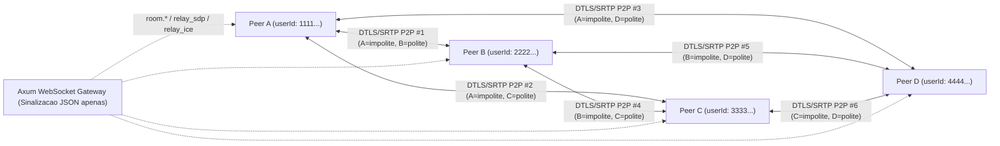
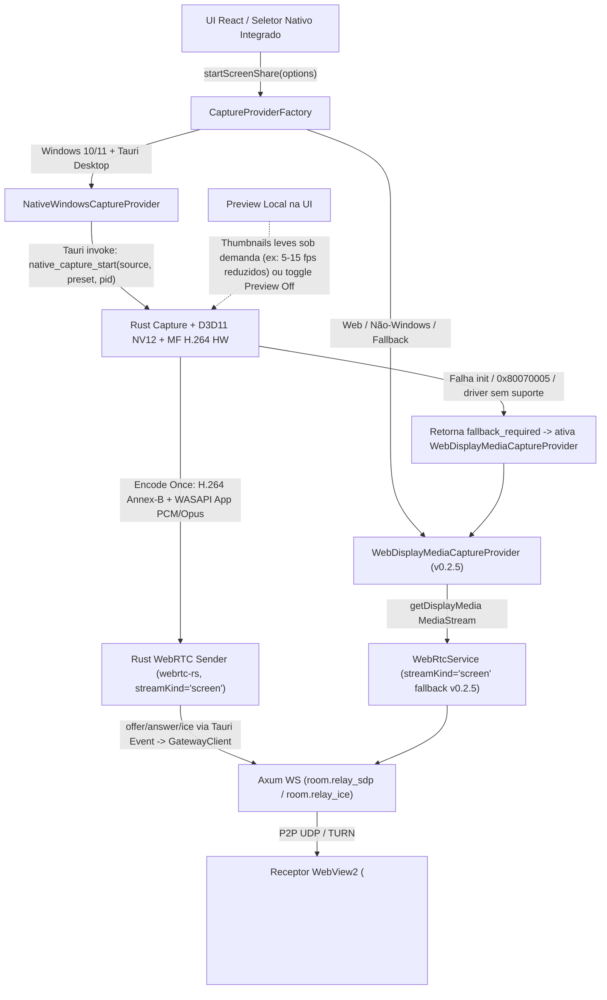

# NEXUS v0.4.0 (Fase A — Fundação): Plano Técnico de Mídia — P2P Mesh Multipessoa, Limites, Qualidade Adaptativa, Transição SFU e Captura Nativa + Fallback

**Status:** Fase A — Arquitetura & Especificação (sem alteração de código funcional da Stable `v0.2.5`)  
**Escopo:** Frente 1 (Captura Nativa Windows + Ponte WebView2/Rust + Fallback `getDisplayMedia`) e Frente 2 (Chamadas e Streaming em Grupo P2P Mesh até 4 participantes pela internet, Controle Adaptativo de Qualidade e Estratégia de Migração para LiveKit SFU)  
**Branch de referência:** `feat/v0.4.0-phase-a-foundation`

---

## 0. Alinhamento com o Roadmap Oficial e Premissas

Conforme diretriz oficial do roadmap pós-Fase A:

1. **Sequência de entregas:** Após concluir a captura nativa (Frente 1), comunidades/servidores (Frente 3) e chamadas multipessoa (Frente 2), a próxima grande etapa será a **modernização completa da interface** (design moderno, premium, original e consistente, preservando a leveza do Tauri 2, com direção visual definida por referências, protótipos e avaliação de UX antes de alterações amplas).
   - **Implicação direta neste plano:** Toda a lógica de sala multipessoa, `RTCPeerConnection`s, transporte nativo, fallback `getDisplayMedia` e telemetria deve ser **desacoplada dos componentes React atuais** (`CallsView.tsx`) por meio de contratos explícitos (`IMediaTransport`, `IScreenCaptureProvider`, `IRoomSignalingClient`, `IRoomCallViewModel`), permitindo substituir a camada visual posteriormente sem refazer o motor de mídia.
2. **NEXUS Plus (Frente 4):** Os contratos de qualidade contemplam extensão futura para personalização e presets avançados (`1440p60`, `1080p120`, `4K30`, `4K60`, temas, emblemas), garantindo que **`720p30`, `720p60`, `1080p30` e `1080p60` permaneçam 100% gratuitos** no tier Free (`nexus_free`), tanto em 1:1 quanto em grupo. Sistemas de pagamento/billing não são implementados nesta fase.
3. **NIX (assistente inteligente):** Permanece oficialmente como a **última grande etapa do roadmap**; nenhuma dependência ou hook invasivo de IA é introduzido na camada de mídia agora.
4. **Integridade da Stable `v0.2.5`:** Nenhum arquivo funcional em `src-tauri/src/`, `nexus-server/src/` ou `src/` é modificado nesta Fase A. O fallback `getDisplayMedia` atual permanece 100% preservado como caminho de contingência.

---

## 1. Diagnóstico do Estado Atual (Stable `v0.2.5` — Modelo 1:1)

A base atual já possui fundamentos sólidos para chamadas 1:1 pela internet, porém todos os contratos assumem cardinalidade fixa de **1 par (`caller_id` ↔ `callee_id`)**:

| Camada | Arquivo / Símbolos Reais | Limitação Atual para Salas Multipessoa |
|---|---|---|
| **Orquestração Frontend** | `src/services/CallService.ts` (`CallService`, `webRtc: WebRtcService \| null`, `activeCallPeer`) | Mantém uma única instância `WebRtcService` e assume um único `activeCallPeer.id` para envio de `offer`, `answer`, `ice_candidate`, `mute` e volume. |
| **Motor WebRTC 1:1** | `src/services/WebRtcService.ts` (`WebRtcService`, `peerConnection`, `remoteAudioElement`, `remoteBoostGain`, `screenVideoSender`, `computeProgressiveBitrateStage`, `rankVideoCodecsForScreenShare`, `computeVideoStatsMetrics`) | Já implementa *Perfect Negotiation* (`isPolite`), fila de ICE (`MAX_CANDIDATE_QUEUE_SIZE = 256`), `GainNode` por peer (`remoteBoostGain` para 101%–200%), VAD local/remoto, rampa progressiva de bitrate e `createIceRestartOffer()`, mas acoplado a um único `RTCPeerConnection`. |
| **Captura de Tela Atual** | `src/services/ScreenCaptureService.ts` (`SCREEN_QUALITY_CONFIGS`, `buildDisplayMediaVideoConstraints`, `startCapture`) | Usa exclusivamente `navigator.mediaDevices.getDisplayMedia()` no WebView2 com consentimento temporário via `screen_set_capture_consent` (`src-tauri/src/lib.rs`). |
| **Store & UI** | `src/stores/useAppStore.ts` (`activeCallPeer`, `isRemoteSpeaking`, `remoteScreenStream`), `src/features/calls/CallsView.tsx` | Estado global e palco de vídeo modelam no máximo 1 stream remoto e 1 stream local. |
| **Sinalização WebSocket Client** | `src/services/GatewayClient.ts` (`sendCallInvite`, `sendCallWebrtcOffer`, `sendCallWebrtcAnswer`, `sendCallWebrtcIceCandidate`) | Já carrega `target_user_id` nos relays WebRTC, mas só possui eventos de ciclo de vida 1:1 (`call.invite`, `call.accept`, `call.ended`). |
| **Servidor Axum — Estado de Chamada** | `nexus-server/src/services/calls.rs` (`CallService`, `CallState`, `user_active_calls`), `nexus-server/src/models/mod.rs` (`CallSession`) | `CallSession` possui apenas `caller_id` e `callee_id`; `relay_sdp` e `relay_ice` validam `(s.caller_id == user_id && s.callee_id == target_user_id)` ou o inverso; `end()` e `cleanup_user()` encerram a chamada inteira quando 1 usuário sai. |
| **Gateway WebSocket & Rate Limit** | `nexus-server/src/handlers/ws.rs` (`MAX_ICE_CANDIDATES_PER_SEC = 120`, `MAX_CONTROL_MSGS_PER_SEC = 40`, `MAX_TOTAL_FRAMES_PER_SEC = 160`) | Limite global por conexão WebSocket; em Mesh 4 pessoas, uma rajada simultânea de ICE de 3 peers pode se aproximar do teto de 120/s. |
| **ICE / TURN** | `nexus-server/src/handlers/webrtc.rs` (`get_ice_servers`, `WebrtcState`), `nexus-server/src/config/mod.rs` (`TURN_SECRET`, `TURN_SERVER`), `src-tauri/src/commands.rs` (`webrtc_get_ice_servers`) | Já gera credenciais efêmeras HMAC-SHA1 (`expiry:user_id`, TTL `86400s`) para `turn:<addr>:3478?transport=udp` e `tcp` + STUN Google. |

### Achados Empíricos Locais (`.nexus-lab/capture-prototype` — Windows 11 Build `26300`)

Medições reais coletadas localmente pelo protótipo (`prototype_lab`, máquina: `AMD Ryzen 7 5700X` 8C/16T, `15.92 GiB` RAM, `AMD Radeon RX 5500 XT` 8 GB VRAM, monitor `1920x1080 @ 165 Hz`, sem hardware NVIDIA/Intel presente localmente):

| Métrica Medida (Loopback Local) | WebView2 / Edge `getDisplayMedia` (`v0.2.5`) | Captura Nativa `WGC-Monitor` + `AMDh264Encoder` HW (`native-bench`) |
|---|---|---|
| **Encoder H.264 efetivo** | **`OpenH264` (CPU, `gpuEnc=0%`)**, mesmo priorizando H.264 `42e01f` no SDP; decoder caiu em `FFmpeg` fallback | **`AMDh264Encoder` HW zero-copy** via `IMFDXGIDeviceManager` (`gpuEnc avg 8.44%–10.42%`) |
| **FPS sustentado `720p30`** | `29.99 enc` / `29.99 rvfc` (`0` drops) | `30.14 fps` (`drops=0`, `misses=0`) |
| **FPS sustentado `1080p30`** | `29.99 enc` / `29.49 rvfc` (`0` drops) | `30.13 fps` (`drops=0`, `misses=0`) |
| **FPS sustentado `1080p60`** | `53.99 enc` / **`32.12 rvfc`** (`10/433 playbackDropped`) | **`60.10 fps`** (`drops=0`, `misses=0`) |
| **Latência encode / cap→NALU** | `avgEncodeTime`: `6.48 / 13.62 / 6.97 ms` | `TOTAL_CAP_TO_NALU avg`: `5.00 / 6.35 / 5.81 ms` |
| **CPU do processo** | `3.96% – 5.06%` | `0.28% – 0.72%` |
| **Memória (Working Set)** | `725.5 – 988.9 MB` (`9–18` processos) | `92.7 – 106.0 MB` (`Private 79.6 – 105.9 MB`) |
| **Artefatos visuais do SO/Browser** | Barra flutuante `Chrome_WidgetWin_1` (`609x70`) em captura de tela inteira | Sem barra do navegador; `SetIsBorderRequired(false)` retorna `Ok(())` após `StartCapture()` (pixel visual não verificado em desktop isolado `exebox`) |

> **Nota de Honestidade Científica:** Os números acima são de captura/encode/loopback **em uma única máquina** com GPU AMD. Em chamadas reais pela internet, restam por medir em campo: latência ponta-a-ponta entre 2+ computadores distintos, concorrência de GPU com jogos 3D em tela cheia, comportamento de encoders NVIDIA NVENC e Intel QSV, e estabilidade sob NAT simétrico via TURN.

---

## 2. Arquitetura P2P Mesh Multipessoa (Frente 2 — Meta Inicial: até 4 Participantes, sem Tailscale)

### 2.1 Topologia Multi-Peer e Regra Determinística Anti-Glare

Em uma sala Mesh com $N \le 4$ participantes, cada cliente mantém um mapa de sessões peer-to-peer indexado por `participantId` (`Uuid`), com $N - 1$ ligações `RTCPeerConnection` (máximo de $3$ peers remotos por usuário e $\frac{4 \times 3}{2} = 6$ conexões P2P totais na sala):



#### Regra Determinística de Polidez e Iniciação (Zero *SDP Glare*)
Mantemos e generalizamos a convenção já existente em `src/services/CallService.ts:551`:
- **Comparação lexicográfica de UUIDs normalizados em lowercase:**
  $$\text{isPolite}(u_{\text{local}}, u_{\text{remoto}}) = (u_{\text{local}} > u_{\text{remoto}})$$
- **Iniciador determinístico no `peer_joined`:** Para evitar que ambos os lados enviem `Offer` no instante em que o Peer D entra na sala com `{A, B, C}`:
  - **Regra de entrada (`join`):** O **peer recém-chegado (`newcomer`)** cria as ofertas iniciais para todos os participantes já presentes na sala (ou o peer de menor `userId` cria; adotando *newcomer-offers* o recém-chegado já possui sua lista completa de `existingPeers` na resposta `room.joined` e dispara as `N-1` ofertas imediatamente em paralelo, reduzindo 1 RTT de sinalização).
  - **Proteção contra *glare* em renegociações subsequentes** (ex.: Peer A e Peer B ativam `screen_share` ou `restartIce` no mesmo milissegundo):
    1. Cada `PeerLink` possui sua própria `signalingQueue` FIFO serializada (`enqueueSignaling`, padrão de `WebRtcService.ts`).
    2. Em colisão (`pc.signalingState === 'have-local-offer'` ao receber uma `Offer` remota):
       - O peer **impolite** (`localUserId < remoteUserId`) **ignora** a `Offer` concorrente e aguarda a `Answer` da sua própria oferta.
       - O peer **polite** (`localUserId > remoteUserId`) executa `await pc.setLocalDescription({ type: 'rollback' })`, aplica a `Offer` remota e responde com `Answer`.
    3. Como o par `(A, B)` possui ordenação total estrita (`Uuid` distintos), é matematicamente impossível ambos serem `polite` ou ambos serem `impolite`.

### 2.2 Gerenciamento de Sala no Servidor Axum (`nexus-server`)

O servidor Axum AWS atua **exclusivamente como plano de controle e sinalização JSON**. Mídia RTP/SRTP **nunca** passa pelo processo Axum.

#### Preservação do Fluxo 1:1 + Novo Domínio de Salas (`RoomService`)
Para não quebrar as chamadas DM 1:1 da Stable `v0.2.5`, `CallService` (`nexus-server/src/services/calls.rs`) continua atendendo `call.*` 1:1 intacto, enquanto um novo `RoomService` (ou módulo irmão compartilhando `PresenceManager` e regras de bloqueio/permissão) gerencia salas multipessoa:

```rust
// Modelo conceitual Planejado (Fase B — não implementar na Fase A)
pub const MAX_MESH_PARTICIPANTS: usize = 4;

pub enum RoomKind {
    GroupDmCall { group_id: Uuid },
    CommunityVoiceChannel { community_id: Uuid, channel_id: Uuid },
}

pub struct RoomParticipantState {
    pub user_id: Uuid,
    pub connection_id: Uuid, // vincula à sessão WS que entrou na sala (multi-aba seguro)
    pub is_muted: bool,
    pub is_deafened: bool,
    pub is_screen_sharing: bool,
    pub active_preset: Option<String>, // "720p30" | "1080p30" | "1080p60" | ...
    pub joined_at: DateTime<Utc>,
}

pub struct RoomSession {
    pub room_id: Uuid,
    pub kind: RoomKind,
    pub transport_mode: TransportMode, // P2pMesh | SfuLiveKit (futuro)
    pub max_participants: usize,       // 4 no P2P Mesh
    pub participants: HashMap<Uuid, RoomParticipantState>,
    pub created_at: DateTime<Utc>,
}
```

#### Protocolo de Sinalização Multipessoa via WebSocket (`ws.rs`)

| Direção | `op` / `type` | Payload Essencial | Comportamento / Invariantes |
|---|---|---|---|
| C → S | `room.join` | `{ room_id, kind, channel_id?, capabilities }` | Valida autenticação, banimento/bloqueio, permissão (`CONNECT_VOICE` em comunidades), e limite `participants.len() < max_participants`. Se o usuário já estava em outra sala/conexão, remove da anterior atomicamente (*single active voice room per user*). |
| S → C (entrante) | `room.joined` | `{ room_id, self_user_id, transport_mode, participants: [...], ice_servers? }` | Entrega snapshot autoritativo dos peers já na sala (incluindo `is_muted`, `is_screen_sharing`, `active_preset`) para o entrante iniciar as conexões. |
| S → C (demais) | `room.peer_joined` | `{ room_id, participant: { user_id, username, display_name, avatar_url, is_muted, is_screen_sharing } }` | Notifica apenas os outros membros ativos da sala; ninguém existente derruba conexão com os demais. |
| C → S | `room.leave` | `{ room_id }` | Remove apenas o remetente; os demais permanecem conectados entre si. |
| S → C (demais) | `room.peer_left` | `{ room_id, user_id, reason }` | Demais peers fecham **apenas** `peers.get(user_id)` e liberam seu `AudioContext`/`GainNode`/vídeo remoto. |
| C → S → C | `room.relay_sdp` | `{ room_id, target_user_id, stream_kind: "voice" \| "screen", sdp_type: "offer" \| "answer", sdp }` | Axum verifica `participants.contains_key(&sender_id) && participants.contains_key(&target_user_id)` e repassa adicionando `sender_id`. |
| C → S → C | `room.relay_ice` | `{ room_id, target_user_id, stream_kind: "voice" \| "screen", candidate }` | Mesmo roteamento ponto-a-ponto validado por pertinência à sala (`EventPriority::Critical`). |
| C → S → C | `room.participant_state` | `{ room_id, is_muted?, is_deafened?, is_screen_sharing?, active_preset? }` | Atualiza estado autoritativo na `RoomSession` e faz broadcast para a sala (classificado como `Ephemeral` exceto `is_screen_sharing`, que altera estado de mídia). |

#### Entrada/Saída Sem Derrubar Demais Participantes e Limpeza em Queda de Rede
- **Desconexão abrupta de WebSocket (`ws.rs:581-587`):** Hoje `cleanup_user(user_id)` só roda quando `is_now_offline` (última conexão WS caiu). Em salas com múltiplas abas/sessões, vinculamos a entrada na sala ao `connection_id` específico: se *aquela* conexão WS cair (ou perder heartbeat de 60s), apenas o `participant` sai da `RoomSession` via `room.peer_left(reason: "connection_lost")`, **preservando os outros $N-1$ participantes em chamada contínua**.
- **Ajuste de Rate Limit no Gateway (`ws.rs:26-29`):**
  - Hoje: `MAX_ICE_CANDIDATES_PER_SEC = 120`, `MAX_TOTAL_FRAMES_PER_SEC = 160`.
  - Cenário de pico em Mesh 4 pessoas: quando o 4º participante entra (ou executa `restartIce()` em todos os 3 links), ele pode emitir 3 links × 25 ICE candidates (host + srflx + relay UDP/TCP) = ~75 candidates em < 1s; se usar sessão dual (`voice` + `screen`), pode chegar a 150 candidates/s, atingindo o teto atual de `120` (que descarta excedentes) ou `160` (`MAX_TOTAL_FRAMES_PER_SEC`, que **encerra o WebSocket**!).
  - **Plano para Fase B:** Elevar `MAX_ICE_CANDIDATES_PER_SEC` para `240` e `MAX_TOTAL_FRAMES_PER_SEC` para `320` (ou implementar *ICE trickle batching* no cliente agrupando candidatos a cada 25ms em arrays de até 16 candidatos por frame JSON), evitando falsos positivos de flood durante `join`/`ICE restart`.

### 2.3 STUN Público + TURN Próprio (`TURN_SERVER` / `TURN_SECRET`)

O repositório já possui a implementação REST RFC 5766/7635 em `nexus-server/src/handlers/webrtc.rs:32-90`:
- **STUN público:** `stun:stun.l.google.com:19302`, `stun1`, `stun2` (resolução de endereço reflexivo em NAT Full/Restricted/Port-Restricted Cone — zero custo de servidor para o NEXUS).
- **TURN próprio (`coturn` via `TURN_SERVER` e `TURN_SECRET`):**
  - Autenticação efêmera HMAC-SHA1 (`username = "<unix_expiry>:<user.id>"`, TTL = `86400s`) com `turn:<addr>:3478?transport=udp` e `turn:<addr>:3478?transport=tcp`.
  - **Papel no Mesh:** Resolve NAT simétrico e redes corporativas/universitárias que bloqueiam UDP direto.
  - **Invariante de arquitetura:** O servidor **Axum** nunca recebe nem retransmite RTP; apenas o servidor **TURN (coturn)** dedicado atua como relay ICE quando `host`/`srflx` falham.
  - **Impacto de custo/banda do TURN em Mesh 4 pessoas (ponto de atenção):** Se **1 único peer** atrás de NAT simétrico estiver transmitindo tela `1080p60` (~4.5 Mbps) para 3 colegas, o `coturn` recebe `4.5 × 3 = 13.5 Mbps` e envia `13.5 Mbps` (`27 Mbps` agregados = ~`12.15 GB/hora` de tráfego AWS só para 1 streamer atrás de TURN!). Por isso, o detector de rota (`localCandidateType === 'relay' || remoteCandidateType === 'relay'` em `WebRtcTransportDiagnostics`) deve alimentar o algoritmo adaptativo com teto mais conservador quando o link estiver em `relay`.

### 2.4 Controles por Participante, Áudio Web Audio Graph, VAD, Reconexão e Grade React

#### A. Mixagem de Áudio e Volume Individual (`0%` a `200%`)
No modelo 1:1 atual (`WebRtcService.ts:1701-1729, 1958-1983`), cada peer cria um `<audio>` e um `AudioContext` com `GainNode` para boost acima de 100%. Para salas de até 4 participantes (e futuro SFU com mais participantes):
- **Grafo recomendado por sala (1 único `AudioContext` compartilhado + elementos `<audio>` ou `AudioDestination`):**
  - Se mantivermos `<audio>` com `setSinkId` (para seleção dinâmica de dispositivo de saída no Windows/WebView2): criar 1 `<audio>` por peer para faixa `0%–100%` e compartilhar **1 único `AudioContext` da sala** contendo por peer `{ sourceNode, boostGainNode (0..1 para 101%–200%), analyserNode (VAD) }` conectados ao `audioCtx.destination` (aplicando `setSinkId` também no `AudioContext` quando suportado pelo Edge/Chromium 110+ ou roteando via `MediaStreamAudioDestinationNode` → único `<audio>` mestre com `setSinkId`).
  - **Vantagem do grafo unificado (`source -> gainNode(0.0..2.0) -> masterGain(0.0..1.0) -> MediaStreamAudioDestinationNode -> <audio>.setSinkId`):**
    1. Garante que **100% do áudio (inclusive boost 101%–200%)** respeite o `outputDevice` escolhido via `setSinkId` (hoje o `remoteBoostGain` vai direto para `remoteAudioContext.destination`, que pode divergir de `remoteAudioElement.sinkId` quando o usuário troca o fone!).
    2. Reduz de $N$ `AudioContext`s para **1 único `AudioContext`**, evitando limite de contextos de áudio do Chromium e economizando threads WASAPI.
    3. Permite `setParticipantVolume(peerId, 0..200)` e mute local individual de áudio do peer de forma instantânea e sem cliques (usando `gain.setTargetAtTime(..., currentTime, 0.015)`).

#### B. Silenciamento Local (`audio` / `video`) e VAD por Peer
- **Áudio:**
  - `localMuted`: desabilita `track.enabled = false` no `MediaStreamTrack` de microfone para todos os links e envia `room.participant_state { is_muted }` via WS.
  - `localDeafened`: zera `masterGain` local, silencia todos os `AnalyserNode`s remotos na UI e força `localMuted = true`.
  - **Mute individual de participante remoto (`localPeerMuted[peerId]`):** zera apenas o `gainNode` daquele peer localmente (sem afetar outros usuários da sala).
- **Vídeo (stream de tela):**
  - Transmissor: `stopScreenShare()` remove/substitui a track de vídeo em todos os peers sem interromper o áudio.
  - Receptor: botão "Ocultar / Parar de assistir stream" desabilita o playback/decoding local (`transceiver.direction = 'recvonly' -> 'inactive'` ou sinalização `stream_unsubscribe` futura no SFU) para poupar CPU/GPU/download do espectador.
- **VAD (Detecção de Fala) por Peer:**
  - VAD local reutiliza `VoiceActivityDetector` (`src/lib/voiceActivity.ts`) com `inputSensitivity` + `voiceHangoverMs`.
  - VAD remoto roda no loop único de 50ms do `AudioContext` da sala sobre o `AnalyserNode` de cada `peerId`, atualizando `speakingPeers: Record<string, boolean>` (sem timer por peer).

#### C. Reconexão Automática por Peer (`restartIce()` + Backoff)
Em vez de um único `reconnectingTimer` global que derruba toda a chamada (`CallService.ts:1201-1203`), cada `PeerLink` gerencia sua própria recuperação:
- Quando `connectionState === 'disconnected'` ou `iceConnectionState === 'disconnected'` para o peer $P$:
  1. Aguarda janela curta de tolerância (`3000 ms` — menor que os `12000 ms` atuais para evitar silêncio prolongado, pois micro-quedas UDP costumam autorrecuperar ou exigir ICE restart rápido).
  2. Se continuar desconectado, marca **apenas** $P$ como `'reconnecting'` e inicia backoff exponencial (`1500 ms`, `2400 ms`, `3840 ms` — até 3 tentativas de `createIceRestartOffer()` direcionadas apenas a $P$ via `room.relay_sdp`).
  3. Se o WebSocket do próprio cliente cair e voltar (`onReconnected`), dispara `restartIce()` apenas nos peers que não estiverem `'connected'`.
  4. Se todas as tentativas para $P$ falharem após ~15s, marca o link com $P$ como `'failed'` (exibindo botão "Reconectar" ou aguardando `room.peer_left`), **sem encerrar a sala com os demais peers**.

#### D. Grade Dinâmica React Desacoplada (Preparada para a Futura Modernização de UI)
- Estado da sala exposto via **ViewModel reativo** (`RoomCallSnapshot`), nunca acoplando objetos `RTCPeerConnection` ou `MediaStream` diretamente à árvore de UI como props rígidas:
  - **Modo Palco + Miniaturas (quando há $\ge 1$ stream de tela ativo):**
    - Área principal (Stage): 1 stream em foco (selecionado pelo usuário ou automaticamente o último stream iniciado, com troca de foco em 1 clique).
    - Faixa lateral/inferior (Strip de Miniaturas): cards compactos para os demais streams ativos (mini-preview ou placeholder pausado se o usuário ocultou) + tiles de voz dos participantes sem stream ativo.
  - **Modo Grade de Voz (quando $0$ streams de tela estão ativos):**
    - Grade simétrica responsiva: 1 coluna (2 participantes), 2×2 (3–4 participantes), cada card exibindo avatar, anel de fala VAD (`speakingPeers[id]`), ícones de mute/deafen, indicador de qualidade/reconexão do link e popover de volume individual (`0%–200%`).

---

## 3. Análise Honesta de Limites do P2P Mesh & Controle Adaptativo de Qualidade

### 3.1 Premissas da Modelagem Matemática

Adotamos os valores reais definidos em `src/services/ScreenCaptureService.ts:53-98`, acrescidos do perfil intermediário **`720p60`** e do overhead real de áudio + transporte:

| Preset | Resolução | FPS | Bitrate Alvo Típico (RTP Vídeo) | `minBitrate` / `maxBitrate` Planejados |
|---|---|---|---|---|
| `720p30` | `1280×720` | `30` | **`1.8 – 2.2 Mbps`** (usaremos `2.2 Mbps` no pior caso contínuo e `1.8 Mbps` típico) | `0.9` / `2.2 Mbps` |
| `720p60` | `1280×720` | `60` | **`2.8 – 3.2 Mbps`** (usaremos `3.2 Mbps` no pior caso) | `1.3` / `3.2 Mbps` |
| `1080p30` | `1920×1080` | `30` | **`3.0 – 3.5 Mbps`** (usaremos `3.5 Mbps` no pior caso) | `1.5` / `3.5 Mbps` |
| `1080p60` | `1920×1080` | `60` | **`4.5 – 5.0 Mbps`** (usaremos `5.0 Mbps` no teto de `SCREEN_QUALITY_CONFIGS`) | `2.2` / `5.0 Mbps` |
| **Áudio Voz (Opus)** | — | — | **`~0.064 Mbps` (`64 kbps`)** por link (incl. overhead RTP/SRTP) | DTX/FEC opcional |

> **Fórmulas para uma sala Mesh com $N$ participantes ($N-1$ peers remotos por usuário) e $S_{\text{total}}$ streams de tela simultâneos:**
> - **Conexões UDP/DTLS/SRTP por participante:** $C = N - 1$ (total na sala: $\frac{N(N-1)}{2}$).
> - **Upload de um Streamer** (envia seu stream para todos os $N-1$ peers + áudio de voz):
>   $$\text{Upload}_{\text{streamer}} = (N - 1) \cdot B_{\text{vídeo}} + (N - 1) \cdot 0.064\text{ Mbps}$$
> - **Download de um Viewer puro** (recebe $S$ streams + $N-1$ áudios):
>   $$\text{Download}_{\text{viewer}} = S \cdot B_{\text{vídeo}} + (N - 1) \cdot 0.064\text{ Mbps}$$
> - **Download de um Streamer que também assiste a $(S - 1)$ streams remotos:**
>   $$\text{Download}_{\text{streamer}} = (S - 1) \cdot B_{\text{vídeo}} + (N - 1) \cdot 0.064\text{ Mbps}$$
> - **Decoders de vídeo paralelos em CPU/GPU:**
>   - Viewer puro: **$S$ decoders simultâneos**.
>   - Quem também transmite: **$S - 1$ decoders simultâneos** + **1 encoder (pipeline nativo Rust *Encode Once*)** OU **até $N - 1$ encoders (WebView2 `RTCPeerConnection` independentes)**.

---

### 3.2 Matrizes Completas de Banda, Conexões e Encode/Decode (2, 3 e 4 Participantes)

*(Valores calculados no teto máximo do preset — `2.2 / 3.2 / 3.5 / 5.0 Mbps` — acrescidos de `64 kbps` de áudio por peer remoto. Para `1080p60` típico a `4.5 Mbps`, subtrair `0.5 Mbps` por cópia.)*

#### Cenário A: $N = 2$ Participantes (`1` conexão P2P total; $1$ link por usuário)

| Streams ($S$) | Preset | Upload (Streamer) | Download (Viewer) | Encodes (Nat. / Web) | Decodes (Viewer / Streamer) | Veredito Realista |
|---|---|---|---|---|---|---|
| **1** | `720p30` | `2.26 Mbps` | `2.26 Mbps` | `1` / `1` | `1` / `0` | Trivial em qualquer banda larga |
| **1** | `720p60` | `3.26 Mbps` | `3.26 Mbps` | `1` / `1` | `1` / `0` | Muito confortável |
| **1** | `1080p30` | `3.56 Mbps` | `3.56 Mbps` | `1` / `1` | `1` / `0` | Confortável |
| **1** | `1080p60` | `5.06 Mbps` | `5.06 Mbps` | `1` / `1` | `1` / `0` | Bom com upload $\ge 8$ Mbps; **WebView2 atual caiu a `32 rvfc` em `OpenH264`** |
| **2** (ambos) | `1080p30` | `3.56 Mbps` | `3.56 Mbps` | `1` / `1` | `1` / `1` | Simétrico, leve em HW |
| **2** (ambos) | `1080p60` | `5.06 Mbps` | `5.06 Mbps` | `1` / `1` | `1` / `1` | Exige GPU HW encode+decode simultâneo; se `OpenH264` CPU, sobrecarrega |

*(Obs.: $S = 3$ é impossível com $N = 2$ com 1 screen share por pessoa.)*

---

#### Cenário B: $N = 3$ Participantes (`3` conexões P2P totais; `2` links UDP por usuário)

| Streams ($S$) | Preset | Upload (Streamer) | Download (Viewer puro) | Upload/Down (Quem transmite e assiste) | Encodes (Nat. / Web) | Decodes (Viewer / Streamer) |
|---|---|---|---|---|---|---|
| **1** | `720p30` | `4.53 Mbps` | `2.33 Mbps` | Up `4.53` / Down `0.13` | `1` / `2` | `1` / `0` |
| **1** | `720p60` | `6.53 Mbps` | `3.33 Mbps` | Up `6.53` / Down `0.13` | `1` / `2` | `1` / `0` |
| **1** | `1080p30` | `7.13 Mbps` | `3.63 Mbps` | Up `7.13` / Down `0.13` | `1` / `2` | `1` / `0` |
| **1** | `1080p60` | **`10.13 Mbps`** | `5.13 Mbps` | Up `10.13` / Down `0.13` | `1` / `2` | `1` / `0` |
| **2** | `720p30` | `4.53 Mbps` | `4.53 Mbps` | Up `4.53` / Down `2.33` | `1` / `2` | `2` / `1` |
| **2** | `720p60` | `6.53 Mbps` | `6.53 Mbps` | Up `6.53` / Down `3.33` | `1` / `2` | `2` / `1` |
| **2** | `1080p30` | `7.13 Mbps` | `7.13 Mbps` | Up `7.13` / Down `3.63` | `1` / `2` | `2` / `1` |
| **2** | `1080p60` | **`10.13 Mbps`** | **`10.13 Mbps`** | Up `10.13` / Down `5.13` | `1` / `2` | `2` / `1` |
| **3** | `720p30` | `4.53 Mbps` | — | Up `4.53` / Down `4.53` | `1` / `2` | — / `2` |
| **3** | `720p60` | `6.53 Mbps` | — | Up `6.53` / Down `6.53` | `1` / `2` | — / `2` |
| **3** | `1080p30` | `7.13 Mbps` | — | Up `7.13` / Down `7.13` | `1` / `2` | — / `2` |
| **3** | `1080p60` | **`10.13 Mbps`** | — | Up `10.13` / Down **`10.13 Mbps`** | `1` / `2` | — / **`2`** |

---

#### Cenário C: $N = 4$ Participantes (`6` conexões P2P totais; `3` links UDP por usuário)

| Streams ($S$) | Preset | Upload (Streamer) | Download (Viewer puro) | Upload / Download (Quem transmite e assiste) | Encodes (Nat. / Web) | Decodes (Viewer / Streamer) | Limite Crítico |
|---|---|---|---|---|---|---|---|
| **1** | `720p30` | `6.79 Mbps` | `2.39 Mbps` | Up `6.79` / Down `0.19` | `1` / `3` | `1` / `0` | Viável na maioria das conexões ($\ge 10$ Mbps up) |
| **1** | `720p60` | `9.79 Mbps` | `3.39 Mbps` | Up `9.79` / Down `0.19` | `1` / `3` | `1` / `0` | Exige upload estável $\ge 12–15$ Mbps |
| **1** | `1080p30` | `10.69 Mbps` | `3.69 Mbps` | Up `10.69` / Down `0.19` | `1` / `3` | `1` / `0` | Exige upload estável $\ge 15$ Mbps |
| **1** | `1080p60` | **`13.7 – 15.2 Mbps`** (`4.5–5.0 × 3`) | `4.7 – 5.2 Mbps` | Up **`15.2`** / Down `0.19` | `1` / **`3`** | `1` / `0` | **Gargalo #1: upload do streamer** (e 3× encode se WebView2) |
| **2** | `720p30` | `6.79 Mbps` | `4.59 Mbps` | Up `6.79` / Down `2.39` | `1` / `3` | `2` / `1` | Equilibrado; bom fallback automático em Mesh 4p |
| **2** | `720p60` | `9.79 Mbps` | `6.59 Mbps` | Up `9.79` / Down `3.39` | `1` / `3` | `2` / `1` | Exige GPU decodificando 2×720p60 |
| **2** | `1080p30` | `10.69 Mbps` | `7.19 Mbps` | Up `10.69` / Down `3.69` | `1` / `3` | `2` / `1` | Bom em fibra simétrica ($\ge 15$ Mbps up) |
| **2** | `1080p60` | **`13.7 – 15.2 Mbps`** | **`9.2 – 10.2 Mbps`** | Up **`15.2`** / Down `5.19` | `1` / **`3`** | **`2`** / `1` | **Viewer decodifica 2×1080p60; Streamer: 1 encode (Nat.) ou 3 (Web) + 1 decode** |
| **3** | `720p30` | `6.79 Mbps` | `6.79 Mbps` | Up `6.79` / Down `4.59` | `1` / `3` | `3` / `2` | Máximo realista para WebView2 fallback em 4p |
| **3** | `720p60` | `9.79 Mbps` | `9.79 Mbps` | Up `9.79` / Down `6.59` | `1` / `3` | `3` / `2` | Alto consumo de decoder em GPUs integradas antigas |
| **3** | `1080p30` | `10.69 Mbps` | `10.69 Mbps` | Up `10.69` / Down `7.19` | `1` / `3` | `3` / `2` | 3×1080p30 decode paralelo + 10.7 Mbps upload |
| **3** | `1080p60` | **`13.7 – 15.2 Mbps`** | **`13.7 – 15.2 Mbps`** | Up **`15.2`** / Down **`10.19 Mbps`** | `1` / **`3`** | **`3`** / **`2`** | **Limite extremo do Mesh:** 3 decodes 1080p60 no viewer; 1–3 encodes + 2 decodes no streamer |

### 3.3 Conclusões Técnicas Honestas da Modelagem

1. **Por que o Pipeline Nativo Rust (`Encode Once`) é indispensável para Mesh 4p em `1080p60`:**
   - No fallback `WebView2 getDisplayMedia`, o Edge usa `OpenH264` em CPU (`~5%` CPU para 1 link `1080p60` entregando apenas `32.12 rvfcFps`). Multiplicar por 3 peers em Mesh significa 3 encodes de CPU (~15%+ CPU contínuo só para captura/encode antes mesmo de rodar o jogo), tornando `1080p60` multi-peer impraticável via browser.
   - No pipeline nativo Rust (`WGC/DXGI → D3D11 NV12 → MF H.264 HW`), a GPU codifica **1 única vez** (`~0.7%` CPU, `~8.4%–10.4%` VideoEncode na RX 5500 XT) e os NALUs Annex-B são replicados para os 3 contextos RTP/SRTP em memória.
2. **Por que o P2P Mesh tem teto físico em 4 participantes (e exige SFU depois):**
   - Mesmo com *Encode Once*, o **upload de rede** do streamer continua multiplicado por $N - 1$. Em `1080p60` (`4.5–5.0 Mbps` por stream), `13.5–15.0 Mbps` contínuos de upload saturam facilmente conexões ADSL/VDSL/cabo assimétricas (ex.: 300/15 Mbps ou Wi-Fi instável) ou conexões via `TURN`.
   - Em $N = 5$ ou $N = 6$, `1080p60` em Mesh exigiria `20–25 Mbps` constantes de upload do streamer — inviável como arquitetura padrão.
3. **Decoders em paralelo nos Viewers:**
   - Um viewer com GPU dedicada moderna (RX 5500 XT / RTX / Intel UHD) decodifica 2–3× `1080p60` em `D3D11VideoDecoder` com facilidade, **porém** iGPUs antigas ou quando o WebView2 cai em `FFmpeg` software decoder (como ocorreu no `web-bench`!) não sustentam 3× `1080p60` sem queda de FPS. Por isso, **apenas o stream em foco no palco deve permanecer em resolução/FPS totais**; miniaturas ou streams ocultos devem sofrer redução de taxa/resolução (ou pause) assim que possível.

---

### 3.4 Algoritmo de Controle Adaptativo de Qualidade

O algoritmo opera em um loop de controle a cada **`1.0s`–`2.0s`** usando métricas reais de `getStats()` (WebRTC) ou do `NativeP2pSender` (Rust), com **prioridade absoluta de QoS para áudio Opus** sobre qualquer stream de vídeo.

#### A. Entradas Observadas por Link ($k \in \{1 \dots N-1\}$)
- `qualityLimitationReason[k]`: `'none' | 'bandwidth' | 'cpu' | 'other'`
- `availableOutgoingBitrate[k]` (bps, do `candidate-pair` selecionado)
- `packetLossPct[k]`, `rttMs[k]`, `rttBaselineMs[k]`
- `nackRate[k]` (NACKs/s) e `pliRate[k]` (keyframes solicitados/s)
- `encodedFps` vs `requestedFps` e `encoderTimeAvgMs` (no pipeline nativo: frame budget de `16.6ms` em 60fps / `33.3ms` em 30fps)

#### B. Regras com Histerese (Anti-*Flapping*)
- **Janela de Downgrade (Rápida):** Aciona após **3 amostras ruins consecutivas** (`~3–4 segundos`).
- **Janela de Recuperação (Lenta):** Só tenta subir 1 degrau após **15–20 segundos contínuos** sem `bandwidth`/`cpu` limitation, perda `< 1.0%` e `availableOutgoingBitrate` com folga $\ge 1.35\times$ o próximo degrau.
- **Teto de Degraus por Sessão:** Máximo 1 mudança de resolução/FPS a cada 10s para evitar resets constantes de decoder nos espectadores.

#### C. Fluxo de Decisão (Duas Camadas)

1. **Camada 1 — Orçamento Proativo ao Iniciar/Entrar na Sala (Pré-alocação):**
   - Estima `uploadBudgetBps` conservador a partir do mínimo `availableOutgoingBitrate` observado após a rampa inicial (ou limite configurado pelo usuário).
   - Reserva áudio: `audioOverheadBps = (N - 1) * 80_000` (64 kbps + margem).
   - Calcula teto por stream:
     $$B_{\text{max\_stream}} = \left\lfloor \frac{0.80 \cdot \text{uploadBudgetBps} - \text{audioOverheadBps}}{S_{\text{self}} \cdot (N - 1)} \right\rfloor$$
   - Se o usuário escolheu `auto`, seleciona automaticamente o maior preset da escada (`1080p60` $\rightarrow$ `1080p30` $\rightarrow$ `720p60` $\rightarrow$ `720p30`) cujo `initialBitrate` caiba em $B_{\text{max\_stream}}$.
   - Se algum link usar ICE `relay` (TURN), aplica fator de segurança adicional `0.75` sobre `maxBitrate` para conter explosão de tráfego no servidor TURN.

2. **Camada 2 — Reação em Tempo Real Durante a Transmissão:**
   - **Caso 1: Gargalo de Banda (`qualityLimitationReason === 'bandwidth'` ou perda $> 3\%$ ou RTT $> 2.5 \times \text{baseline}$):**
     - *Passo 1 (Bitrate, sem trocar resolução):* Reduz `targetBitrate` do link afetado (WebView2) ou do encoder nativo em `25%` (piso = `minBitrate` do preset).
     - *Passo 2 (FPS / Escala — após mais 3s saturado no `minBitrate`):*
       - Se `preset === '1080p60'`: reduz para **`1080p30`** (se `contentHint === 'detail'`) ou **`720p60`** (se `contentHint === 'motion'`).
       - Se `1080p30` ou `720p60`: reduz para **`720p30`**.
       - Se `720p30` ainda saturar: reduz bitrate até `500 kbps` e `15 fps` antes de pausar vídeo para salvar o áudio.
   - **Caso 2: Gargalo de CPU/GPU (`qualityLimitationReason === 'cpu'` ou `encodedFps < 0.75 * targetFps` ou `encodeAvgMs > 0.85 * frameIntervalMs`):**
     - Como é gargalo local da máquina transmissora, aplica **downgrade coordenado global** em todos os links: `1080p60 → 1080p30 → 720p30` (e em último caso `720p30 @ 20fps`), exibindo aviso discreto na UI (`qualityFallbackNotice`).
   - **Política para o Pipeline Nativo (*Encode Once*) com Peers Heterogêneos:**
     - Se 2 peers têm fibra (recebem `1080p60`) e 1 peer tem link de `2 Mbps`:
       - *MVP Fase B:* O encoder único acompanha o **menor denominador comum sustentável** (ou `1080p30` a `2.2 Mbps`) até um piso (`720p30`), evitando duplicar encodes.
       - *Evolução Fase C / SFU:* Com **2 camadas simulcast** (ex.: `High = 1080p60` e `Low = 720p30` quando suportado) ou via LiveKit SFU com SVC/Simulcast, o peer lento assina apenas `Low` sem degradar os demais.

---

## 4. Estratégia de Transição P2P Mesh → LiveKit SFU

### 4.1 Por que e Quando Migrar do Mesh para o LiveKit SFU

| Critério | P2P Mesh (Frente 2 — Fase B) | LiveKit SFU (Frente 2 — Expansão) |
|---|---|---|
| **Participantes na sala** | **$2 \le N \le 4$** | **$N \ge 5$** (comunidades, watch parties, eventos) |
| **Custo de servidor de mídia** | Zero (exceto fallback TURN em NAT simétrico) | SFU dedicado na AWS (`sa-east-1`) recebendo 1 stream e distribuindo $N-1$ cópias |
| **Upload do streamer (1 stream `1080p60`)** | $(N - 1) \times 5\text{ Mbps}$ (`15 Mbps` em 4p) | **Constante $1 \times 5\text{ Mbps}$** (ou $+1.5\text{ Mbps}$ se Simulcast `Low` ativo), independente de $N$ |
| **Qualidade para peers heterogêneos** | Limitado pelo upload do transmissor / link mais fraco | **Simulcast / Selective Forwarding:** espectador em foco recebe `1080p60`; miniaturas recebem `360p15`/`720p30` ou ficam pausadas |
| **Presets NEXUS Plus (`1440p60`, `4K30/60`)** | Viável apenas 1:1 (ou 3p em fibra simétrica) | Recomendado via SFU para $\ge 3$ participantes devido à banda de upload |

#### Gatilhos Objetivos de Transição Automática / Política de Sala
1. **Regra de cardinalidade (`HARD_MESH_LIMIT = 4`):** Toda chamada em grupo até 4 participantes inicia em `P2pMeshTransport` (zero custo de banda no servidor). Se um 5º usuário solicitar `room.join` em uma sala configurada para escalar (ex.: canal de voz de comunidade), o servidor responde com `transport_mode: 'sfu_livekit'` + credenciais JWT do LiveKit para todos os clientes executarem *handoff* controlado de `MeshMediaTransport` → `LiveKitSfuMediaTransport` atrás da mesma interface `IMediaTransport`.
2. **Regra de saturação de upload/streams:** Se `S >= 2` e `uploadBudget` do streamer em Mesh cair abaixo de `720p30` para todos os links apesar de banda individual suficiente para 1 único upload, a sala pode promover para SFU (quando disponível na infraestrutura).
3. **Regra de tier futuro (`NEXUS Plus`):** Streams `1440p60` / `4K30` / `4K60` em salas com $N \ge 3$ utilizam SFU por padrão.

### 4.2 Fluxo de Autorização no Backend (Axum = Plano de Controle Único)

Mesmo após introduzir o LiveKit SFU, o **Axum (`nexus-server`) continua sendo a autoridade única**:
1. Cliente solicita `POST /v1/rooms/:roomId/media-token` (ou via `room.join` no WS).
2. Axum valida: sessão ativa, participação na comunidade/grupo, permissões RBAC (`CONNECT_VOICE`, `SPEAK`, `SCREEN_SHARE`), banimentos/bloqueios e **entitlement** do preset solicitado (`1080p60` sempre permitido no Free; `1440p60`/`4K` somente se transmissor possuir entitlement `nexus_plus`).
3. Axum emite JWT efêmero assinado com `canPublish`, `canPublishSources` (restringindo `screen_share` se o usuário não tiver permissão) e `canSubscribe` (sempre liberado para assistir qualquer qualidade se hardware/banda suportarem).

---

## 5. Contratos TypeScript de Desacoplamento (`IMediaTransport`, `IScreenCaptureProvider`, `IRoomSignalingClient`, `StreamQualitySpec`)

Estes contratos definem a fronteira arquitetural entre **Motor de Mídia/Captura**, **Sinalização** e **Interface React** (preparando o terreno para Fases B/C e para a futura modernização completa da UI sem retrabalho).

```typescript
// ============================================================================
// Contratos Planejados — Fase A (v0.4.0)
// Desacoplam UI, Captura (Nativa vs getDisplayMedia) e Transporte (Mesh vs SFU)
// ============================================================================

export type QualityTier = 'nexus_free' | 'nexus_plus';

// Free (100% gratuito em 1:1 e grupo): auto, 720p30, 720p60, 1080p30, 1080p60
// Futuro NEXUS Plus (apenas quem transmite precisa do entitlement): 1440p60, 1080p120, 4k30, 4k60
export type StreamQualityPresetId =
  | 'auto'
  | '720p30'
  | '720p60'
  | '1080p30'
  | '1080p60'
  | '1440p60'
  | '1080p120'
  | '4k30'
  | '4k60';

export interface StreamQualitySpec {
  id: StreamQualityPresetId;
  label: string;
  requiredTier: QualityTier; // 'nexus_free' até '1080p60'; 'nexus_plus' acima
  targetWidth: number;
  targetHeight: number;
  maxFramerate: number;
  initialBitrateBps: number;
  minBitrateBps: number;
  maxBitrateBps: number;
  degradationPreference: 'maintain-resolution' | 'balanced' | 'maintain-framerate';
  steadyContentHint: 'detail' | 'motion';
  /** Recomendado SFU acima de N participantes para este preset */
  recommendedSfuAboveParticipants: number;
}

export const STREAM_QUALITY_CATALOG: Record<StreamQualityPresetId, StreamQualitySpec> = {
  auto: {
    id: 'auto',
    label: 'Automático (Adaptativo)',
    requiredTier: 'nexus_free',
    targetWidth: 1920,
    targetHeight: 1080,
    maxFramerate: 60,
    initialBitrateBps: 2_200_000,
    minBitrateBps: 900_000,
    maxBitrateBps: 5_000_000,
    degradationPreference: 'balanced',
    steadyContentHint: 'detail',
    recommendedSfuAboveParticipants: 4,
  },
  '720p30': {
    id: '720p30',
    label: '720p • 30 FPS',
    requiredTier: 'nexus_free',
    targetWidth: 1280,
    targetHeight: 720,
    maxFramerate: 30,
    initialBitrateBps: 1_500_000,
    minBitrateBps: 900_000,
    maxBitrateBps: 2_200_000,
    degradationPreference: 'maintain-resolution',
    steadyContentHint: 'detail',
    recommendedSfuAboveParticipants: 4,
  },
  '720p60': {
    id: '720p60',
    label: '720p • 60 FPS',
    requiredTier: 'nexus_free',
    targetWidth: 1280,
    targetHeight: 720,
    maxFramerate: 60,
    initialBitrateBps: 2_100_000,
    minBitrateBps: 1_300_000,
    maxBitrateBps: 3_200_000,
    degradationPreference: 'balanced',
    steadyContentHint: 'motion',
    recommendedSfuAboveParticipants: 4,
  },
  '1080p30': {
    id: '1080p30',
    label: '1080p • 30 FPS',
    requiredTier: 'nexus_free',
    targetWidth: 1920,
    targetHeight: 1080,
    maxFramerate: 30,
    initialBitrateBps: 2_400_000,
    minBitrateBps: 1_500_000,
    maxBitrateBps: 3_500_000,
    degradationPreference: 'maintain-resolution',
    steadyContentHint: 'detail',
    recommendedSfuAboveParticipants: 4,
  },
  '1080p60': {
    id: '1080p60',
    label: '1080p • 60 FPS',
    requiredTier: 'nexus_free',
    targetWidth: 1920,
    targetHeight: 1080,
    maxFramerate: 60,
    initialBitrateBps: 3_250_000,
    minBitrateBps: 2_200_000,
    maxBitrateBps: 5_000_000,
    degradationPreference: 'balanced',
    steadyContentHint: 'motion',
    recommendedSfuAboveParticipants: 4,
  },
  // Futuros presets NEXUS Plus (sem billing/implementação na Fase A)
  '1440p60': {
    id: '1440p60',
    label: '1440p • 60 FPS',
    requiredTier: 'nexus_plus',
    targetWidth: 2560,
    targetHeight: 1440,
    maxFramerate: 60,
    initialBitrateBps: 5_500_000,
    minBitrateBps: 3_500_000,
    maxBitrateBps: 8_500_000,
    degradationPreference: 'balanced',
    steadyContentHint: 'motion',
    recommendedSfuAboveParticipants: 2,
  },
  '1080p120': {
    id: '1080p120',
    label: '1080p • 120 FPS',
    requiredTier: 'nexus_plus',
    targetWidth: 1920,
    targetHeight: 1080,
    maxFramerate: 120,
    initialBitrateBps: 6_000_000,
    minBitrateBps: 3_800_000,
    maxBitrateBps: 9_000_000,
    degradationPreference: 'maintain-framerate',
    steadyContentHint: 'motion',
    recommendedSfuAboveParticipants: 2,
  },
  '4k30': {
    id: '4k30',
    label: '4K • 30 FPS',
    requiredTier: 'nexus_plus',
    targetWidth: 3840,
    targetHeight: 2160,
    maxFramerate: 30,
    initialBitrateBps: 7_500_000,
    minBitrateBps: 4_500_000,
    maxBitrateBps: 12_000_000,
    degradationPreference: 'maintain-resolution',
    steadyContentHint: 'detail',
    recommendedSfuAboveParticipants: 2,
  },
  '4k60': {
    id: '4k60',
    label: '4K • 60 FPS',
    requiredTier: 'nexus_plus',
    targetWidth: 3840,
    targetHeight: 2160,
    maxFramerate: 60,
    initialBitrateBps: 11_000_000,
    minBitrateBps: 7_000_000,
    maxBitrateBps: 18_000_000,
    degradationPreference: 'balanced',
    steadyContentHint: 'motion',
    recommendedSfuAboveParticipants: 2,
  },
};

// ----------------------------------------------------------------------------
// 1. Provedor de Captura (Captura Nativa Windows vs Fallback getDisplayMedia)
// ----------------------------------------------------------------------------

export type CaptureBackendKind = 'native_windows_wgc_dxgi' | 'browser_get_display_media';

export interface CaptureSourceDescriptor {
  id: string; // Ex.: "monitor:HMONITOR" ou "window:HWND" ou "browser-picker"
  kind: 'monitor' | 'window' | 'browser_picker';
  title: string;
  processName?: string;
  pid?: number;
  width: number;
  height: number;
  dpiScale?: number;
  isHdr?: boolean;
  /** Suporte a áudio exclusivo do aplicativo via WASAPI Process Loopback */
  supportsAppAudioLoopback: boolean;
}

export interface CaptureStartOptions {
  sourceId?: string; // Omitido quando usar picker do browser
  preset: StreamQualityPresetId;
  captureCursor: boolean;
  captureAudioMode: 'none' | 'app_process_loopback' | 'system_loopback';
  targetPid?: number;
}

export interface CaptureSessionHandle {
  sessionId: string;
  backend: CaptureBackendKind;
  /** Presente no fallback browser; null quando o vídeo é codificado direto em Rust sem IPC de frames */
  mediaStream: MediaStream | null;
  /** Identificador da sessão nativa no Rust quando backend === 'native_windows_wgc_dxgi' */
  nativePipelineId: string | null;
  effectiveSpec: {
    width: number;
    height: number;
    frameRate: number;
    encoderName: string | null;
    hardwareAccelerated: boolean;
  };
}

export interface IScreenCaptureProvider {
  readonly backendKind: CaptureBackendKind;
  isSupported(): Promise<boolean>;
  /** Lista monitores e janelas para o seletor integrado React (ou retorna vazio para picker do SO) */
  listSources(): Promise<CaptureSourceDescriptor[]>;
  startCapture(options: CaptureStartOptions): Promise<CaptureSessionHandle>;
  updateQuality(sessionId: string, preset: StreamQualityPresetId): Promise<void>;
  setCursorEnabled(sessionId: string, enabled: boolean): Promise<void>;
  stopCapture(sessionId: string): Promise<void>;
  onCaptureEnded(cb: (sessionId: string, reason: string) => void): () => void;
}

// ----------------------------------------------------------------------------
// 2. Cliente de Sinalização de Sala (Axum WS hoje / extensível para SFU token)
// ----------------------------------------------------------------------------

export type MediaStreamKind = 'voice' | 'screen';

export interface RoomParticipantInfo {
  userId: string;
  username: string;
  displayName: string;
  avatarUrl?: string;
  isMuted: boolean;
  isDeafened: boolean;
  isScreenSharing: boolean;
  activePreset?: StreamQualityPresetId;
}

export interface RoomJoinResult {
  roomId: string;
  transportMode: 'p2p_mesh' | 'sfu_livekit';
  participants: RoomParticipantInfo[];
  iceServers: RTCIceServer[];
  sfuEndpointUrl?: string;
  sfuAccessToken?: string;
}

export interface IRoomSignalingClient {
  joinRoom(params: {
    roomId: string;
    kind: 'group_dm' | 'community_voice';
    channelId?: string;
  }): Promise<RoomJoinResult>;
  leaveRoom(roomId: string): Promise<void>;
  relaySdp(params: {
    roomId: string;
    targetUserId: string;
    streamKind: MediaStreamKind;
    sdpType: 'offer' | 'answer';
    sdp: string;
  }): void;
  relayIceCandidate(params: {
    roomId: string;
    targetUserId: string;
    streamKind: MediaStreamKind;
    candidate: RTCIceCandidateInit;
  }): void;
  updateParticipantState(params: {
    roomId: string;
    isMuted?: boolean;
    isDeafened?: boolean;
    isScreenSharing?: boolean;
    activePreset?: StreamQualityPresetId;
  }): void;
  onPeerJoined(cb: (roomId: string, peer: RoomParticipantInfo) => void): () => void;
  onPeerLeft(cb: (roomId: string, userId: string, reason: string) => void): () => void;
  onPeerStateChanged(cb: (roomId: string, peer: RoomParticipantInfo) => void): () => void;
  onRemoteSdp(
    cb: (msg: {
      roomId: string;
      senderId: string;
      streamKind: MediaStreamKind;
      sdpType: 'offer' | 'answer';
      sdp: string;
    }) => void
  ): () => void;
  onRemoteIceCandidate(
    cb: (msg: {
      roomId: string;
      senderId: string;
      streamKind: MediaStreamKind;
      candidate: RTCIceCandidateInit;
    }) => void
  ): () => void;
}

// ----------------------------------------------------------------------------
// 3. Abstração de Transporte de Mídia (P2P Mesh <-> LiveKit SFU)
// ----------------------------------------------------------------------------

export type PeerLinkHealth = 'connecting' | 'connected' | 'reconnecting' | 'failed' | 'closed';

export interface RemoteScreenFeed {
  participantId: string;
  streamKind: 'screen';
  /** MediaStream para <video> (tanto no fallback quanto quando decodificado pelo WebView2) */
  mediaStream: MediaStream | null;
  isPausedBySender: boolean;
  isHiddenLocally: boolean;
  preset: StreamQualityPresetId | null;
  width: number | null;
  height: number | null;
  fps: number | null;
}

export interface RoomTransportDiagnostics {
  transportMode: 'p2p_mesh' | 'sfu_livekit';
  perPeer: Record<string, WebRtcTransportDiagnostics>; // reusa tipo de src/lib/types.ts
  aggregateUploadKbps: number;
  aggregateDownloadKbps: number;
  activeAdaptivePreset: StreamQualityPresetId;
}

export interface IMediaTransport {
  readonly mode: 'p2p_mesh' | 'sfu_livekit';
  connect(joinResult: RoomJoinResult, localUserId: string): Promise<void>;
  disconnect(): Promise<void>;

  // Áudio de voz
  setLocalMicMuted(muted: boolean): Promise<void>;
  setLocalDeafened(deafened: boolean): Promise<void>;
  setParticipantVolume(participantId: string, volumePercent: number): void; // 0..200
  setParticipantLocalMute(participantId: string, muted: boolean): void;
  setMasterOutputVolume(volumePercent: number): void; // 0..100
  switchAudioInputDevice(deviceId: string): Promise<boolean>;
  switchAudioOutputDevice(deviceId: string): Promise<boolean>;

  // Compartilhamento de tela (aceita captura nativa Rust OU MediaStream getDisplayMedia)
  publishScreenShare(session: CaptureSessionHandle, spec: StreamQualitySpec): Promise<void>;
  updateScreenShareSpec(spec: StreamQualitySpec): Promise<void>;
  unpublishScreenShare(): Promise<void>;
  setRemoteScreenHidden(participantId: string, hidden: boolean): Promise<void>;

  // Observabilidade e estado reativo para UI (desacoplado de JSX)
  getDiagnostics(): Promise<RoomTransportDiagnostics>;
  onPeerHealthChange(cb: (participantId: string, health: PeerLinkHealth) => void): () => void;
  onSpeakingChange(cb: (speakingMap: Record<string, boolean>) => void): () => void;
  onRemoteScreenFeedsChange(cb: (feeds: RemoteScreenFeed[]) => void): () => void;
  onAdaptiveQualityNotice(cb: (notice: string | null) => void): () => void;
}
```

---

## 6. Plano de Integração WebView2 + Nativo (Frente 1 + Fallback `v0.2.5`)

### 6.1 Análise Objetiva das Opções de Ponte entre Rust Nativo e WebView2

Quando a captura de tela (`WGC` / `DXGI`) e a codificação H.264 HW (`AMDh264Encoder` / `NVENC` / `QSV` + fallback `H264 Encoder MFT`) rodam nativamente em Rust (`src-tauri`), existem três formas arquiteturais de ligar esse vídeo ao P2P:

| Abordagem | Como Funciona | Avaliação Técnica Honesta |
|---|---|---|
| **1. Frames brutos via Tauri IPC** | Rust envia BGRA/NV12 por `tauri::ipc` para `<canvas>` / `MediaStream` no WebView2 | **Descartada.** `1920×1080×1.5 bytes × 60fps ≈ 186 MB/s` de cópia CPU/serialização, destruindo o ganho do zero-copy GPU (`0.7%` CPU) e voltando a passar pelo encoder `OpenH264` CPU do WebView2. |
| **2. NALUs H.264 via IPC → WebCodecs / `RTCRtpScriptTransform`** | Rust envia NALUs comprimidos por WebSocket local / custom protocol para o WebView2 | **Frágil no WebView2.** Exige pipeline manual de *packetization* / `VideoDecoder` ou `MediaStreamTrackGenerator` + `RTCRtpScriptTransform` acoplados ao runtime do Chromium/Edge, com alto risco de jitter e dessincronização de timestamps. |
| **3. Transporte WebRTC Nativo em Rust para Screen Share (`streamKind: 'screen'`) + Áudio de Voz preservado no WebView2 (`streamKind: 'voice'`)** *(Recomendada)* | **Dual-Stream sob `IMediaTransport`:**<br>1) **Voz:** permanece no `WebRtcService` WebView2 (preserva AEC3/NS/AGC, `GainNode`, `setSinkId`, hot-swap de microfone da `v0.2.5`).<br>2) **Tela + Áudio do App (WASAPI Process Loopback):** Rust captura na GPU, codifica 1x em H.264 HW (`Encode Once`), empacota RTP/DTLS/SRTP via `webrtc-rs` e envia diretamente aos $N-1$ peers.<br>3) **No Receptor:** o `<video>` do WebView2 recebe o stream `screen` via `RTCPeerConnection` (recebendo os pacotes RTP H.264 direto ou via SDP negociado com o transmissor Rust) e decodifica na GPU via Edge/D3D11! | **Melhor equilíbrio entre performance, segurança e zero regressão:**<br>• Zero frames brutos no IPC.<br>• Transmissor faz **1 único encode HW** para até 3 espectadores.<br>• Receptor continua usando `<video>` HTML5 dentro da UI React (compatível com a futura modernização de UI e com tela cheia/miniaturas).<br>• Custo: 1 `RTCPeerConnection` adicional por peer **somente enquanto houver tela compartilhada**, usando o mesmo endpoint ICE/TURN (`/v1/webrtc/ice-servers`). |

### 6.2 Fluxograma da Ponte WebView2 ↔ Rust Nativo e Fallback Automático



#### Detalhes Críticos de Implementação Planejada (para Fases B/C)
1. **Injeção de SPS/PPS e Resposta a PLI/FIR:** O `NativeScreenSender` em Rust deve prefixar `SPS`/`PPS` em todo frame IDR (keyframe) e reagir imediatamente a pacotes RTCP **PLI** (`Picture Loss Indication`) vindos de qualquer receptor recém-chegado ou após perda de pacotes, solicitando `CODECAPI_AVEncMPVGOPSize` / `CODECAPI_AVEncVideoForceKeyFrame` no `IMFTransform`.
2. **Preview Local Sem Duplicar Encode:** Quando o próprio usuário transmite, a UI não precisa de um stream `1080p60` completo no preview pequeno do card — pode exibir thumbnail leve sob demanda (ex.: frame reduzido a `480x270 @ 5–10 fps` ou opção "Pausar pré-visualização" estilo Discord) economizando VRAM/CPU.
3. **Seletor Nativo Integrado à UI (Sem Barra Flutuante):**
   - `listSources()` chama comando Tauri que enumera monitores (`HMONITOR`, resolução, DPI, HDR flag) e janelas visíveis (`HWND`, título, PID, processo) retornando JSON para o modal React do NEXUS.
   - Assim o usuário escolhe fonte + preset (`720p30`..`1080p60`) + opção "Compartilhar áudio do aplicativo" (WASAPI Process Loopback por PID) + "Mostrar cursor" **em um único diálogo próprio do NEXUS**, eliminando o picker genérico do Edge e a barra flutuante `Chrome_WidgetWin_1` observada no `web-bench`.
4. **Preservação 100% do Fallback `v0.2.5`:**
   - `ScreenCaptureService.ts` e o ramo `attachScreenTrack` de `WebRtcService.ts` permanecem íntegros.
   - Se `NativeWindowsCaptureProvider.startCapture()` retornar erro recuperável (ex.: `HRESULT(0x80070005)` por política de sessão/desktop não-interativo, incompatibilidade de driver MFT ou flag de configuração "Usar captura clássica do navegador"), a `CaptureProviderFactory` realiza *downgrade* transparente para `WebDisplayMediaCaptureProvider`, mantendo o áudio da sala intacto.

---

## 7. Checklist de Execução para Fases Seguintes (Sem Implementação na Fase A)

1. **Fase B (P2P Mesh Voz + Fallback `getDisplayMedia` + Comunidades Base):**
   - Criar `RoomService` e mensagens `room.*` no `nexus-server` mantendo `calls.rs` 1:1 retrocompatível.
   - Ajustar limites de `ws.rs` (ou adicionar trickle ICE batching).
   - Extrair `MeshMediaTransport` (com `Map<participantId, PeerLink>`, grafo `AudioContext` único + `GainNode` por peer, VAD unificado e `restartIce` por peer) e `RoomCallViewModel` consumido por `CallsView`.
   - Implementar controlador adaptativo de qualidade com telemetria por peer (`RoomTransportDiagnostics`).
2. **Fase C (Captura Nativa Windows + Ponte Rust WebRTC + LiveKit SFU quando necessário):**
   - Promover o pipeline validado em `.nexus-lab/capture-prototype/p2p-native/` para `NativeWindowsCaptureProvider` em `src-tauri` com seletor nativo JSON + WASAPI Process Loopback + Encode Once.
   - Realizar **testes reais entre 2 a 4 computadores distintos pela internet** (fibra vs ADSL/4G, com e sem jogo 3D rodando, em GPUs AMD/NVIDIA/Intel e atrás de TURN) para calibrar os limiares reais do algoritmo adaptativo antes de publicar release.
   - Plug-in de `LiveKitSfuMediaTransport` atrás da mesma `IMediaTransport` para salas com $N \ge 5$ ou futuros presets `NEXUS Plus`.
3. **Fase D / Pós-Frentes:**
   - Modernização completa da interface sobre os ViewModels e contratos desacoplados.
   - Ativação de presets `NEXUS Plus` (`1440p60`, `1080p120`, `4K`) mantendo `1080p60` 100% gratuito.
   - NIX por último.
